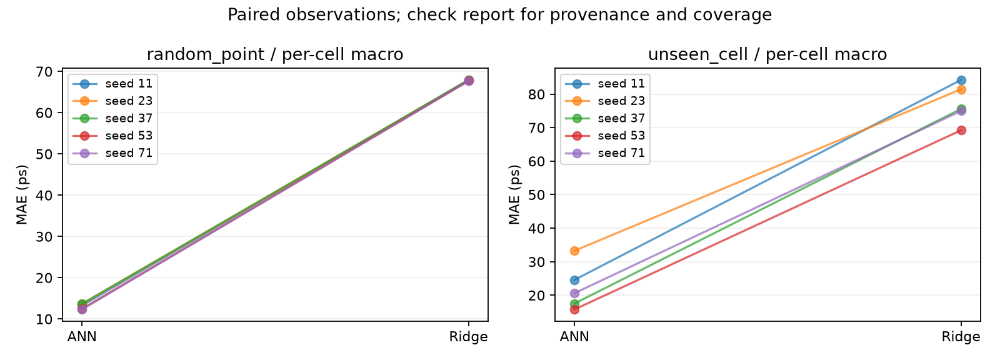
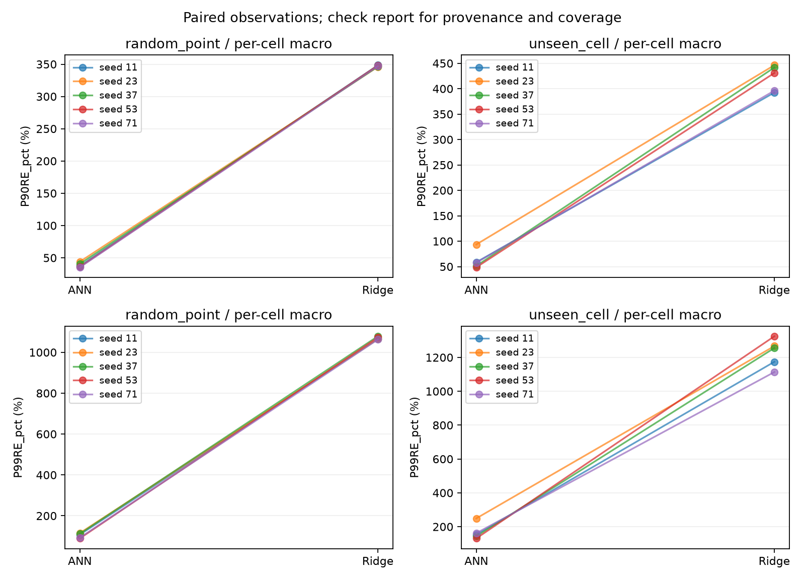

# Global ANN / Global Ridge 配對比較結果

日期：2026-11-03。狀態：**十組 Ridge 訓練、評估完成；ANN 來源核對仍 pending，以下為暫定比較。**

## 研究問題與主要結果

> 在相同輸入資訊與測試資料下，global ANN 相較 global Ridge，是否降低預測誤差，以及改善幅度多少？

依已凍結的資料、42 個特徵及測試 manifests，十組配對的主要指標皆為 ANN 誤差較低。Random-point 的 per-cell macro MAE 平均改善 **80.75%**，unseen-cell 平均改善 **71.33%**。這支持本輪預期的比較方向；仍需原 ANN checkpoint metadata 核對實際訓練設定與 normalization，才能完成來源資格確認。

| 情境 | Seeds | ANN macro MAE，mean ± sample SD（ps） | Ridge macro MAE，mean ± sample SD（ps） | Ridge − ANN（ps） | 差值的描述性 95% t CI（ps） | 平均相對改善 |
|---|---:|---:|---:|---:|---:|---:|
| Random-point | 5 | 13.06 ± 0.65 | 67.82 ± 0.12 | 54.76 | [54.07, 55.46] | 80.75% |
| Unseen-cell | 5 | 22.33 ± 6.96 | 77.12 ± 5.90 | 54.78 | [49.23, 60.34] | 71.33% |

Macro 先對每個 `cell_base` 算誤差，再等權平均。改善率先逐 seed 計算 `100 × (Ridge − ANN) / Ridge`，最後取五組均值，因此不必等於由表中兩個平均 MAE 直接換算的比例。兩種情境不合併成 n=10；CI 使用五筆配對差值與 df=4。

## 逐 seed 主要結果

| 情境 | Seed | ANN macro MAE（ps） | Ridge macro MAE（ps） | 相對改善 |
|---|---:|---:|---:|---:|
| Random-point | 11 | 13.23 | 67.95 | 80.53% |
| Random-point | 23 | 13.65 | 67.84 | 79.88% |
| Random-point | 37 | 13.67 | 67.92 | 79.88% |
| Random-point | 53 | 12.43 | 67.71 | 81.63% |
| Random-point | 71 | 12.30 | 67.69 | 81.83% |
| Unseen-cell | 11 | 24.56 | 84.27 | 70.85% |
| Unseen-cell | 23 | 33.25 | 81.48 | 59.19% |
| Unseen-cell | 37 | 17.51 | 75.60 | 76.84% |
| Unseen-cell | 53 | 15.74 | 69.23 | 77.26% |
| Unseen-cell | 71 | 20.60 | 75.01 | 72.54% |

Unseen-cell 的改善率約 59.19–77.26%，變動明顯大於 random-point；報告時應保留五組結果，不能只以平均值代表所有 held-out cell 組合。這些是每 run 的 macro 指標，不能據此推論每個 individual cell 都有改善。

## 次要指標與尾端誤差

下表均為各 mode 的五 seeds 平均；P90RE/P99RE 為先逐 cell 算相對誤差百分位數，再取 macro 平均，不是把全部點合併後的 percentile。

| 指標 | Random-point ANN | Random-point Ridge | Unseen-cell ANN | Unseen-cell Ridge |
|---|---:|---:|---:|---:|
| Micro MAE（ps） | 9.99 | 56.22 | 14.48 | 56.27 |
| Micro R² | 0.9797 | 0.5582 | 0.9378 | 0.5411 |
| Macro R² | 0.9595 | 0.2802 | 0.8755 | -0.0359 |
| Macro P90RE（%） | 38.57 | 347.20 | 61.92 | 421.56 |
| Macro P99RE（%） | 103.28 | 1069.12 | 167.61 | 1227.19 |

ANN 的 macro P90RE/P99RE 在十組配對皆較低。相對誤差沿用既有近零分母規則；即使相較 Ridge 大幅降低，ANN 的 P99RE 仍高，不能把相對優勢解讀為已滿足 timing sign-off 要求。Ridge 的 unseen-cell micro R² 約 0.54，但 macro R² 約 -0.036，也顯示整體 point-weighted 指標不足以代表平均每個 cell 的品質。本次 Ridge 的所有 macro 指標均無 undefined groups 被排除。

## 方法與執行核對

- 規格：[比較計畫](PLAN_GLOBAL_ANN_RIDGE_COMPARISON.md)；實作版本 `af9e137`。正式執行期間未改動求解器、特徵、切分、lambda grid 或指標定義。
- ASAP7 原始 Parquet 12,073,208 rows，200 個 `cell_base`，含 SEQ；混合 delay + transition，並非 delay-only。
- Dataset SHA-256：`79ae211cec386a170455f6fdf0d38c1043d835786408d5aa93c94a1bec855ba5`。
- 固定 `random_point` / `unseen_cell` × seeds `11,23,37,53,71`；沿用原 ANN 42 維 features、manifests、validation mask 與 metrics helpers。沒有 L1/type merge、少量 cells 篩選或 v4 特徵替換。
- Ridge 採 float64 串流 moments、fit-only normalization、未正則化的截距；六個固定 lambda 由 validation MSE 選出，未看 test 選參數，也未用 fit+validation 重訓。保留負 targets 與負 predictions。
- 七組選到 lambda `1e-4`；`random_point/53`、`unseen_cell/53`、`unseen_cell/71` 選到 `1e-8`。這是固定 grid 的結果，未因候選落在邊界而事後擴張 grid。
- 10/10 完成，無失敗或省略；每組 source/test 筆數、test cell groups、negative targets 均通過檢查。結果生成後另跑一次 `aggregate`，重新核對 dataset、凍結來源、ANN 結果與全部保存產物 checksum，成功完成。
- 十組訓練加評估合計 **1,873.73 秒（31.23 分鐘）**，單組 **124.69–248.50 秒**。不含開發、等待核准、額外聚合及報告整理，也不與另一台主機的 ANN 訓練耗時直接比較。
- 程序最大 peak working set **1,214,738,432 bytes（約 1.13 GiB）**，batch 目標 100,000 rows；未一次載入全量特徵矩陣。同一程序連跑九組時，peak 是累積程序峰值，並非各 run 獨立量測。
- 既有 ANN 未重訓或重做推論；沿用發布於 `4178b2f8d74cfd2ebe3454283fea969da3c44a75` 的對應指標。該 commit 是結果參考版本，不當作 checkpoint 的實際訓練 commit。

## 論文表述的限制與接續

目前可以描述「在鎖定資料與比較規格下，ANN 的主要誤差與尾端相對誤差均低於本次 global Ridge baseline」。不能把結果推廣為所有模型、所有製程或每個 cell 的保證，也不能據此判斷 L1 merge 是否更好。

十組 ANN metadata 均為 `ann_provenance_pending`，尚未核對 checkpoint 實際 normalization、`max_rows` 與訓練來源。因此不宣稱完整重現 ANN，**沒有輸出正式 p-value 或 Holm 顯著性結論**。五 seeds 共享來源資料，描述性 t CI 也依賴假設，並非跨 library 不確定性的估計。

下一步在原 ANN 訓練電腦匯出 `scripts/export_ann_ridge_metadata.py`，帶回十組 JSON，再依 [執行指南](GLOBAL_ANN_RIDGE_RUNBOOK.md) 重新 aggregate。來源比對若有 mismatch，先解決差異；不為維持有利結果而調整資格。Git commit 的來源 hash 也不能獨立證明當年訓練不存在未提交修改。

可追溯資料：

- [逐 seed 配對表](../experiments/global_ann_ridge_v1/aggregate/paired_metrics.csv)
- [分 mode 的 mean / SD / CI](../experiments/global_ann_ridge_v1/aggregate/summary_by_mode.csv)
- [十組完成與來源資格狀態](../experiments/global_ann_ridge_v1/aggregate/comparison_status.json)
- [自動產生的報告](../experiments/global_ann_ridge_v1/report.md)
- [輸入核對](../experiments/global_ann_ridge_v1/input_audit.json) 與 `evaluations/<run>/` 的訓練 metadata、指標及逐 cell CSV。

凍結 config 保留執行前快照；實際完成狀態以各 run 的 status 與本報告為準。模型權重、Parquet 與暫存不進 Git，小型結果與圖表可供檢閱。`.gitattributes` 保留本次結果的原始檔案位元組，避免跨平台 LF/CRLF 轉換破壞產物 checksum。
