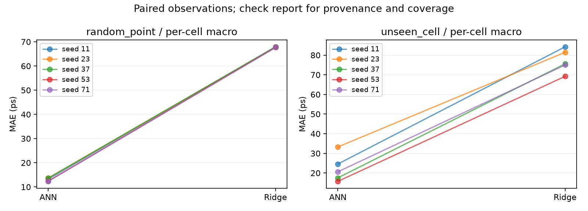
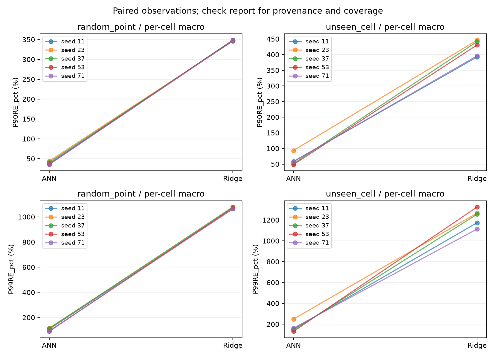

# NLDM-ANN 實驗進度與成果綜合報告

**專案名稱**：`nldm-ann`（以人工神經網路取代 NLDM 查表）
**同步分支**：`plan-v4`（同步時最新 commit：`f3250eb`；此 commit 只在 `plan-v4`，尚未合併進 `main`）
**報告日期**：2026 年 11 月 15 日（初稿由 Gemini 撰寫，同日依原始結果檔校訂，並經獨立 subagent 逐項核對）
**研究目標**：以不使用 Cell ID / Corner ID embedding、只吃連續物理與電氣特徵的 Global ANN 預測 Liberty NLDM 時序值，評估其在未見元件（unseen cell）與未見角點（unseen corner）上的泛化能力，並與線性 baseline 比較。

> **數據來源**：
> - ANN vs. Ridge：`docs/RESULTS_GLOBAL_ANN_RIDGE_COMPARISON.md` 與 `experiments/global_ann_ridge_v1/aggregate/`
> - 40-run 泛化結果：`experiments/asap7_generalization_v1/runs/aggregate/`（`summary_by_mode.csv`、`summary_by_mode_corner.csv`、`run_metrics.csv`）
> - Exp A：`experiments/expA_v2/summary_ci.csv`、`paired_difference_ci.csv`

---

## 摘要

1. **ANN 在主要指標上低於線性 baseline**：在相同 42 維特徵、相同測試 manifests 與 fit-only normalization 下，10 組配對（2 種模式 × 5 seeds）的 macro MAE 皆為 Global ANN 低於 Global Ridge。
   - Random-point：ANN 13.06 ps vs. Ridge 67.82 ps，平均相對改善 80.75%。
   - Unseen-cell：ANN 22.33 ps vs. Ridge 77.12 ps，平均相對改善 71.33%，但各 seed 介於 59.19%–77.26%，變異明顯較大。
2. **泛化難度（描述性）**：Random-point（13.06 ps）< Unseen-cell（22.33 ps）≈ Unseen-corner（25.63 ps）< Joint-unseen（35.42 ps）。Unseen-cell 與 unseen-corner 的信賴區間大幅重疊，無法判定何者較難。
3. **SS 角點明顯最難**：逐角點拆開後，hold-out SS 的 macro MAE（unseen-corner 33.70 ps、joint 47.18 ps）明顯高於 FF 與 TT。
4. **限制**：ANN 的 macro P99 相對誤差仍高於 100%，尚未達到 timing sign-off 的要求。此外，目前尚未在未見元件/角點的情境下與「業界實際作法」（相鄰角點插值、derating、同類元件代用表）比較，這是論文主張成立前必須補上的實驗（見第五節）。

---

## 一、實驗演進脈絡

```
[階段 1：Pilot（Exp A）]
- Nangate45（125 cells，3,540 tables）
- Per-table 64x64 MLP vs. 雙線性插值（LUT），4 種 holdout 比例 × 5 seeds
- 結果：在所有 holdout 比例下，MLP 的 overall MAE 都是 LUT 的 4.7–9.9 倍，
  差值的 95% CI 皆不含 0。
  → 結論：在「表格存在」的情況下，查表法明顯較好；ANN 的價值需轉向「表格不存在」的情境。
        ↓
[階段 2：全域架構（ASAP7）]
- ASAP7 7nm，12,073,208 rows，200 個 cell_base，含循序元件（DFF/LATCH）
- 42 維連續特徵（見 2.0 節）
- 不使用 Cell ID / Corner ID embedding，使模型可套用於未見元件與角點
        ↓
[階段 3：40-run 泛化基準]
- 4 種切分模式（random-point、unseen-cell、unseen-corner、joint-unseen）
- 詳細切分方式見 2.2 節
        ↓
[階段 4：Global Ridge 線性 baseline 配對比較]
- 10 組配對比較（random-point、unseen-cell × 5 seeds）
- Ridge 採 float64 串流 moments 計算
- 2026-11-11 完成 ANN checkpoint metadata 來源核對（見第三節）
```

---

## 二、關鍵實驗數據

### 2.0 輸入特徵（42 維）

| 類別 | 特徵 |
| :--- | :--- |
| 表格軸 | `log_slew`、`log_load` |
| PVT | `process_code`、`nom_voltage_v`、`nom_temperature_c` |
| 元件電氣屬性 | `drive_strength`、`related_pin_cap_ff`（及兩者的缺值旗標）、輸入/輸出 pin 數 |
| 邏輯功能 | function 中的 input / NOT / AND / OR / XOR 計數；logic type one-hot（INV、BUF、AND、NAND、OR、NOR、XOR、XNOR、AO、AOI、OA、OAI、MUX、DFF、LATCH、CLOCK、OTHER） |
| Vt 類別 | one-hot（SLVT、LVT、RVT、SRAM、UNKNOWN） |
| 表格類型 | one-hot（cell_rise、cell_fall、rise_transition、fall_transition） |

### 2.1 Global ANN vs. Global Ridge

相同 42 維特徵輸入下，五個 seed 的平均值 ± 樣本標準差：

| 情境 | 指標 | Global ANN | Global Ridge | 差值（Ridge − ANN） | 差值的描述性 95% t CI | 平均相對改善 |
| :--- | :--- | :---: | :---: | :---: | :---: | :---: |
| **Random-point** | Macro MAE (ps) | **13.06 ± 0.65** | 67.82 ± 0.12 | 54.76 | [54.07, 55.46] | **80.75%** |
| | Micro MAE (ps) | **9.99** | 56.22 | 46.23 | – | – |
| | Macro R² | **0.9595** | 0.2802 | – | – | – |
| | Micro R² | **0.9797** | 0.5582 | – | – | – |
| | Macro P90RE (%) | **38.57** | 347.20 | – | – | – |
| | Macro P99RE (%) | **103.28** | 1069.12 | – | – | – |
| **Unseen-cell** | Macro MAE (ps) | **22.33 ± 6.96** | 77.12 ± 5.90 | 54.78 | [49.23, 60.34] | **71.33%** |
| | Micro MAE (ps) | **14.48** | 56.27 | 41.79 | – | – |
| | Macro R² | **0.8755** | -0.0359 | – | – | – |
| | Micro R² | **0.9378** | 0.5411 | – | – | – |
| | Macro P90RE (%) | **61.92** | 421.56 | – | – | – |
| | Macro P99RE (%) | **167.61** | 1227.19 | – | – | – |



說明：
- Macro 指標先對每個 `cell_base` 計算，再等權平均；P90RE/P99RE 亦為先逐 cell 取百分位數再平均。
- 平均相對改善為逐 seed 計算 `100 × (Ridge − ANN) / Ridge` 後取平均，不等於直接用表中兩個平均 MAE 換算。
- 配對 t 檢定（雙尾，Holm 校正後）：random-point p = 5.16 × 10⁻⁹，unseen-cell p = 1.06 × 10⁻⁵。**每種模式只有 5 個 seed，來源 library 相同且切分重疊，p 值僅供參考**，主要解讀應以改善幅度、逐 seed 結果與尾端誤差為主。
- 尾端誤差：ANN 的 macro P90RE / P99RE 在 random-point 約為 Ridge 的 1/9 至 1/10，在 unseen-cell 約為 1/7。
- Ridge 在 unseen-cell 的 micro R² 約 0.54、macro R² 約 -0.04，顯示 point-weighted 指標不足以代表每個 cell 的平均品質，兩者應並列呈現。
- 本結果只能說明 ANN 優於「這個」線性 baseline，不足以證明非線性模型是必要的，也不能推廣到其他模型或製程。



#### 逐 seed 結果

| 情境 | Seed 11 | Seed 23 | Seed 37 | Seed 53 | Seed 71 |
| :--- | :---: | :---: | :---: | :---: | :---: |
| Random-point 改善率 | 80.53% | 79.88% | 79.88% | 81.63% | 81.83% |
| Unseen-cell 改善率 | 70.85% | **59.19%** | 76.84% | 77.26% | 72.54% |

- Random-point：5 組共 1,000 個 cell/run 觀測，MAE 全部是 ANN 較低。
- Unseen-cell：5 組共 200 個 cell/run 觀測中，197 個是 ANN 較低（同一 cell 可能在不同 seed 重複出現，不視為 200 個獨立樣本）。
- 三個 ANN 較差的 cell 全部來自 seed 23：`BUFx4_ASAP7_75t`（ANN 88.29 / Ridge 78.72 ps）、`DFFLQNx3_ASAP7_75t`（58.19 / 54.38 ps）、`DFFLQNx2_ASAP7_75t`（57.41 / 55.51 ps）。
- Seed 23 的訓練紀錄：validation loss 最佳的是第 4 個 epoch，第 12 個 epoch 結束時停止，符合 patience=8 的 early stopping 規則。**目前不能據此判定欠擬合或將其視為誤差較高的原因**，需另行分析（見第五節）。

### 2.2 ASAP7 40-run 泛化基準

**切分方式**：

| 模式 | 測試集如何產生 | Runs |
| :--- | :--- | :---: |
| Random-point | 隨機抽測試點，每個 seed 一個切分 | 5 |
| Unseen-cell | 每個 seed 隨機 hold-out 40 個 cell_base（20%） | 5 |
| Unseen-corner | 依序 hold-out FF、SS、TT 三個角點；**每個角點只有一個固定測試集**，5 個 seed 只改變模型初始化 | 3 × 5 = 15 |
| Joint-unseen | 每個 seed 抽一組 hold-out cell，同一組 cell 再分別與 FF、SS、TT 組合 | 5 × 3 = 15 |

**整體結果**：

| 切分模式 | Runs | Macro MAE (ps) | 95% CI (ps) | Macro RMSE (ps) | Macro R² | Micro MAE (ps) | Micro R² |
| :--- | :---: | :---: | :---: | :---: | :---: | :---: | :---: |
| **Random-point** | 5 | 13.06 ± 0.65 | [12.24, 13.87] | 20.75 | 0.9595 | 9.99 | 0.9797 |
| **Unseen-cell** | 5 | 22.33 ± 6.96 | [13.69, 30.98] | 37.20 | 0.8755 | 14.48 | 0.9378 |
| **Unseen-corner** | 15 | 25.63 ± 7.70 | [21.36, 29.90]* | 40.49 | 0.8265 | 20.94 | 0.8966 |
| **Joint-unseen** | 15 | 35.42 ± 12.01 | [28.77, 42.07]* | 54.06 | 0.6399 | 24.66 | 0.8469 |

\* 以 n=15 計算的 CI 假設各 run 彼此獨立。Unseen-corner 的 15 個 runs 實際只有 3 個測試集，joint 的 runs 也共用 hold-out cell，因此這兩個 CI 可能低估不確定性。

注意 `HANDOFF.md` 中的 RMSE（19.12 / 31.56 / 39.82 / 45.42）是 **Micro** RMSE，與上表的 Macro RMSE 不同，引用時不可混用。

**逐角點結果**（macro MAE，每格 5 runs）：

| Hold-out 角點 | 電壓 / 溫度 | Unseen-corner (ps) | Joint-unseen (ps) |
| :--- | :---: | :---: | :---: |
| FF | 0.77 V / 0 °C | 19.99 ± 3.08 [16.16, 23.82] | 31.79 ± 9.23 [20.34, 43.25] |
| TT | 0.70 V / 25 °C | 23.20 ± 4.05 [18.17, 28.24] | 27.30 ± 4.40 [21.83, 32.76] |
| SS | 0.63 V / 100 °C | **33.70 ± 7.30** [24.64, 42.76] | **47.18 ± 11.34** [33.10, 61.25] |

（unseen-corner 每格的 5 runs 共用同一測試集，標準差只反映模型初始化的變異。）

觀察：
1. **Unseen-cell 與 unseen-corner 難度相近**：兩者信賴區間大幅重疊，runs 數與切分結構也不同，不能下「跨角點比跨元件難」的結論。
2. **SS 角點明顯最難**：在 unseen-corner 與 joint 兩種模式下，hold-out SS 的誤差都最高。值得注意的是，TT 在電壓/溫度上位於 FF 與 SS 之間，但 hold-out FF（同樣是外插）反而是 unseen-corner 中最容易的，因此難度不能單純用「內插 vs. 外插」解釋。可能的原因（例如 SS 的延遲數值本身較大、非線性較強）尚待分析，目前不做歸因。
3. **Joint-unseen 是明顯的弱點**：Micro R² 為 0.847，但 macro R² 只有 0.640，代表部分 cell 預測品質不佳。應誠實呈現兩個指標，不宜只強調 micro R²。

---

## 三、方法論與可追溯性

1. **防止資料外洩**：
   - 特徵標準化採 fit-only normalization（只用訓練集計算均值與標準差）。
   - Ridge 的 lambda 只依 validation MSE 從固定的六個候選值中選出（七組選 1e-4，random_point/53、unseen_cell/53、unseen_cell/71 選 1e-8），未看 test set，也未事後擴張 grid。
2. **計算資源（與外洩無關，單獨列出）**：Ridge 以串流 moments 分批計算（batch 100,000 rows），不需一次載入全量特徵矩陣，程序峰值記憶體約 1.13 GiB；10 組訓練加評估共 31.23 分鐘。
3. **ANN 來源核對（2026-11-11）**：
   - 核對的是 checkpoint 的 **metadata 與保存結果**：dataset/manifest hash、42 維特徵順序、fit normalization 統計量（最大絕對差約 1.85 × 10⁻¹³）、訓練設定與六份核心原始碼的 Git blob hash，十組皆為 matched。這確認了 ANN 與 Ridge 使用相同的資料、特徵與 normalization。
   - checkpoint 記錄的訓練 commit：`random_point_seed11` 為 `0032cdf`，其餘九組為 `b13d5e8`。`b13d5e8` 是 `0032cdf` 的後代，差異只有 GPU 執行指南與 plan_v4 preflight，不含六份核心訓練原始碼；兩者的 blob hash 均已核對。
   - **ANN 權重不在 repo 中，未重跑推論，也未重算 checkpoint 檔案 hash**，因此這是一致性核對，不等於完整重現 ANN 結果。
4. **資料處理**：
   - 保留負的時序值（負 target 與負 prediction 都納入評估），未做過濾。負值的物理成因本次未分析。
   - 資料同時包含 delay 與 transition 表，涵蓋組合邏輯與循序元件。

---

## 四、論文表述建議

**可以說的**：
- 在鎖定的資料、特徵與切分設定下，Global ANN 的主要誤差與尾端相對誤差均低於 Global Ridge baseline，且在 10/10 組配對中方向一致。
- 不使用 cell / corner embedding 的連續特徵表示，使單一模型能對未見元件與未見角點給出預測，誤差隨外推難度上升。
- 未見角點中，SS 角點的誤差明顯最高。

**不宜說的**：
- 「證實非線性模型的必要性」：只比過一個線性模型。
- 「跨角點比跨元件更難」：信賴區間重疊，切分結構也不同。
- 「內插角點比外插角點容易」：逐角點結果不支持（FF 外插反而最容易）。
- 「已可用於 sign-off」：ANN 的 macro P99RE 仍超過 100%。
- 「已完整重現 ANN」：只做了 metadata 核對。
- 「ANN 優於 NLDM 查表」：Exp A 顯示表格存在時查表法明顯較好；表格不存在時尚未與實務作法比較。
- 「Zero-shot 泛化」作為標題：在補上第五節的實務 baseline 之前，說服力不足。

**建議的論文主軸**：

> 在表格存在時，雙線性插值明顯比 ANN 準（Exp A，誠實呈現此負面結果）；
> 在表格不存在時（新元件、新 PVT 角點），查表法無表可查，這才是以物理特徵為輸入的 ANN 能提供價值的地方。

---

## 五、後續實驗規劃

依優先順序排列：

1. **實務 baseline 比較（最優先）**：口試委員一定會問「沒有表的時候，業界原本怎麼做？」需在相同 test manifests 上比較：
   - Unseen-corner：以其餘角點的表做插值/外插，或以 derating（k-factor）推算。
   - Unseen-cell：以同 logic type、drive strength 最接近的已知元件的表代用。
   ANN 必須在這些情境下優於實務作法，論文主張才完整。
2. **SS 角點分析**：比較 SS 與 FF/TT 的延遲數值範圍、相對誤差與 per-cell 誤差分布，判斷 SS 較難是因為數值較大、非線性較強，還是訓練資料只剩 FF + TT 時的外插問題。
3. **Seed 23 歸因**：利用已有的 history 與 per-cell 資料，比較 seed 23 的 hold-out cell 組成（例如是否包含較多 DFF 或大 drive strength 的 BUF）與其他 seeds 的差異，再判斷是切分難度還是訓練問題。
4. **尾端誤差分析**：找出 P99 相對誤差高的點集中在哪些 cell 類型、哪些 slew/load 區域，並確認近零分母規則對相對誤差的影響。
5. **OpenSTA 端到端整合**：將模型接入 OpenSTA 的 `TableModel.cc`（`GateTableModel::gateDelay`），在實際電路上比較 critical path 的 slack 誤差，這是比 per-point MAE 更有說服力的指標。
6. **跨製程驗證**：在 Sky130 或 GF180MCU 上驗證同一套特徵萃取流程的可攜性。
